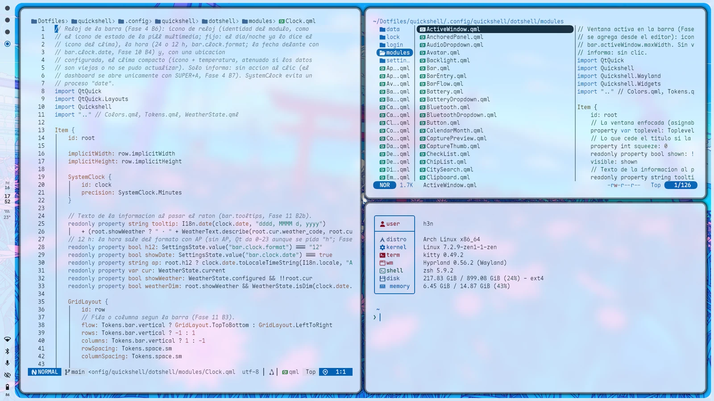
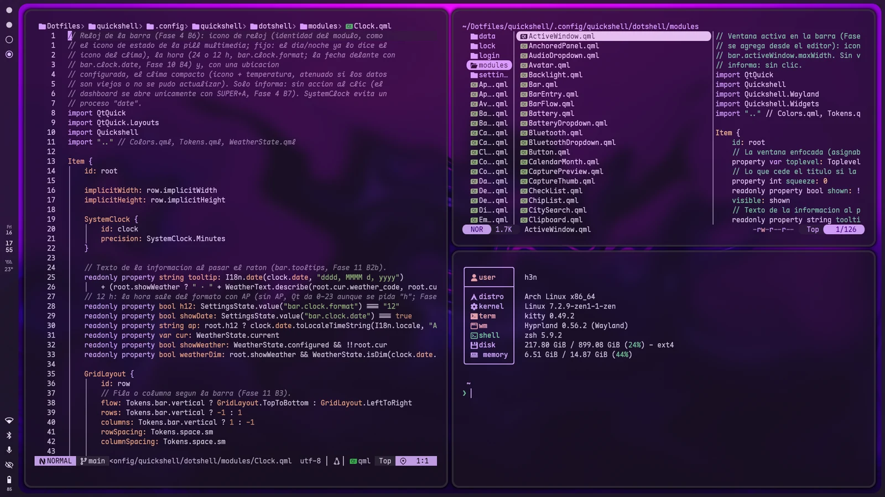
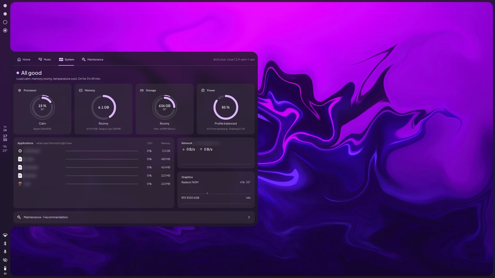
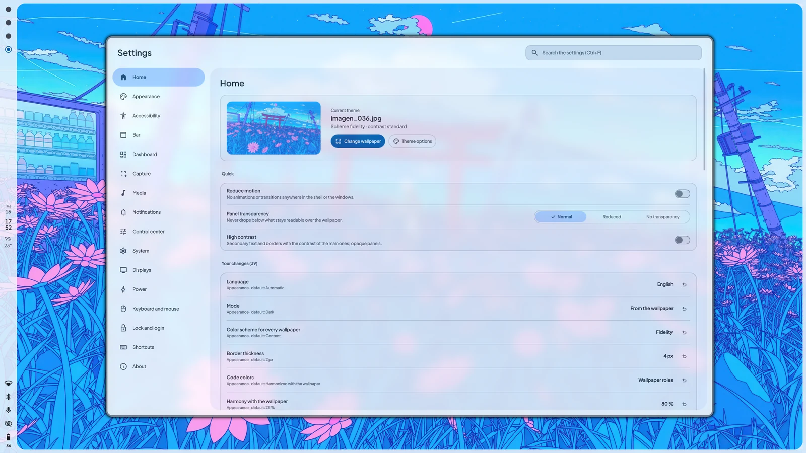
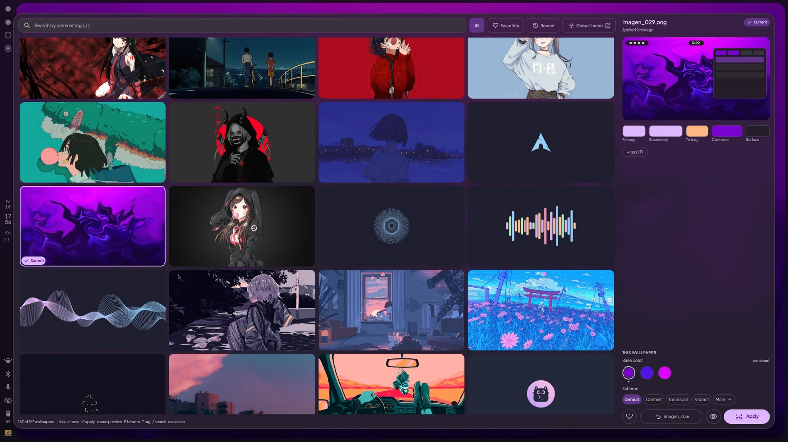
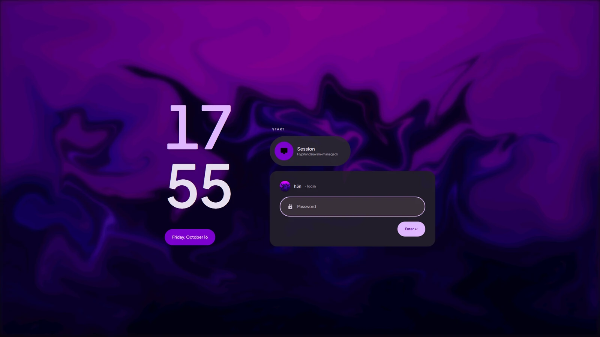
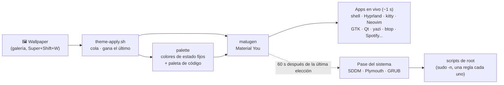

<h3 align="center">
  
  Hyprland Dotfiles
  
  <br/>
  <a href="https://github.com/h3n-x/hyprland-dotfiles">Un escritorio Hyprland completo donde cada color sale de tu wallpaper</a>
  <br/><br/>
  <p>
    🌐 <a href="README.md">English</a> · <strong>Español</strong>
  </p>
</h3>

<p align="center">
  
  
  
  
</p>

<p align="center">
  
  
  
</p>

<p align="center">
  <a href="docs/es/guide.md">Guia</a>
  ·
  <a href="#-inicio-rápido">Instalar</a>
  ·
  <a href="#%EF%B8%8F-atajos">Atajos</a>
  ·
  <a href="LICENSE">Licencia</a>
</p>

&nbsp;

## 🪄 Acerca de

Elegí un wallpaper y **todo el sistema toma sus colores**: la barra y cada panel, la terminal y el editor, las apps GTK y
Qt, los gestores de archivos, Spotify, la pantalla de bloqueo, la de inicio de sesión, el splash de arranque y el menú de
arranque. La paleta es Material You, generada por [matugen](https://github.com/InioX/matugen) a partir de la imagen: una
foto tranquila da un escritorio tranquilo y una vibrante uno vibrante, mientras los avisos, errores y éxitos mantienen
colores fijos y legibles.

La shell está escrita desde cero en QML con [Quickshell](https://quickshell.org): barra, dashboard, centro de control,
lanzador, notificaciones, galería de wallpapers, pantalla de bloqueo y un centro de configuración donde todo se ajusta sin
tocar un archivo. Funciona en cualquier hardware: la GPU se detecta, no está escrita a mano, y cada opción que depende de tu
equipo (pantallas, VRR, HDR, perfiles de energía) aparece solo si tu hardware la soporta.

> [!TIP]
> ¿Curiosidad con cautela? `./install.sh --dry-run` muestra cada comando que correría el instalador, sin cambiar nada.

&nbsp;

## 🎨 Vista previa

<table>
  <tr>
    <td></td>
    <td></td>
  </tr>
  <tr>
    <td colspan="2" align="center"><sub>Las mismas apps, dos wallpapers: todo se recolorea, de la barra a la sintaxis del editor</sub></td>
  </tr>
  <tr>
    <td></td>
    <td></td>
  </tr>
  <tr>
    <td align="center"><sub>Dashboard (<code>Super + A</code>): inicio, música, sistema, escritorios</sub></td>
    <td align="center"><sub>Centro de configuración (<code>Super + I</code>): todas las opciones, con buscador</sub></td>
  </tr>
  <tr>
    <td></td>
    <td></td>
  </tr>
  <tr>
    <td align="center"><sub>Galería de wallpapers (<code>Super + Shift + W</code>) con vista previa en vivo</sub></td>
    <td align="center"><sub>Pantalla de inicio de sesión, la misma superficie que usa el bloqueo</sub></td>
  </tr>
</table>

&nbsp;

## ✨ Lo destacado

| | |
|---|---|
| 🎨 **Un wallpaper, una paleta** | Unas 20 apps se recolorean en vivo en ~1 s: bordes de Hyprland, la shell, kitty, Neovim, btop, yazi, cava, zellij, glow, fzf, starship, GTK 3/4 (Thunar, nwg-look...), Qt, iconos de carpetas de Papirus, Spotify, NetBeans. Modo claro, oscuro o automático. |
| 🖼️ **Galería de wallpapers** | `Super + Shift + W`: búsqueda, etiquetas, favoritos, recientes, vista previa en vivo y opciones de color por wallpaper (esquema, contraste, modo) o para todos. `Super + Shift + Z` deshace el último tema. |
| 🧩 **Una shell completa** | Barra (horizontal o vertical), dashboard con pestañas, centro de control con accesos rápidos editables, lanzador, selector de ventanas, historial del portapapeles, emojis, centro de notificaciones, OSD, menú de energía. |
| 💻 **Colores de código que siguen a la imagen** | Una paleta de sintaxis variada, armonizada hacia el wallpaper y con el contraste resuelto, compartida por Neovim, NetBeans, kitty y glow. |
| 📸 **Capturas** | Pantalla, región o ventana con una vista previa para anotar (satty), copiar, abrir o borrar; grabación de pantalla con una pill en la barra. |
| 🔐 **Bloqueo, inicio de sesión y arranque** | Una pantalla de bloqueo supervisada que se recupera sola, un greeter de SDDM, un splash de Plymouth y un tema de GRUB, todos con la misma paleta. |
| 🎛️ **Configurable sin archivos** | `Super + I`: pantallas (con prueba de 15 s que se revierte sola), luz nocturna, fuentes, escala de la interfaz, menos movimiento, disposición de la barra, zonas del dashboard, capturas, energía... |
| 🌍 **Tres idiomas** | Inglés, español y japonés, se cambian en vivo, de la barra al menú de arranque. |
| ⚡ **Liviano** | Nada consulta en segundo plano mientras está cerrado, las animaciones corren solo con cambios reales, los servicios arrancan a pedido. |

&nbsp;

## 🧭 Cómo funciona



El pase en vivo recolorea lo que ves al momento; el del sistema espera un minuto para que recorrer wallpapers no rehaga la
imagen de arranque cada vez. Los detalles de cada app están en la [guía](docs/es/guide.md).

&nbsp;

## 🐧 Distribuciones soportadas

| Distribución | Estado | Notas |
|---|---|---|
| **Arch Linux** | ✅ Probada | La referencia |
| **EndeavourOS** | ✅ Probada | Usa su yay; dracut y systemd-boot contemplados |
| **CachyOS** | ✅ Probada | Lo del AUR que ya compila sale de sus repos; Limine contemplado |
| **Garuda** | ✅ Probada | Usa paru y Chaotic-AUR si están |
| **Manjaro** | ✅ Probada | El instalador se detiene si sus paquetes son más viejos de lo que la config necesita |
| **Artix** | ⚠️ Lo mejor posible | OpenRC, runit, dinit, s6; ofrece los repos de Arch (algunos paquetes solo están ahí) |

Cada una se instala desde cero en un contenedor: instalación completa, una segunda pasada que no cambia nada, `doctor` y
desinstalación. Cualquier otra distribución que se declare basada en Arch se acepta con un aviso.

&nbsp;

## 🚀 Inicio rápido

```bash
git clone https://github.com/h3n-x/hyprland-dotfiles.git ~/Dotfiles
cd ~/Dotfiles
./install.sh --dry-run   # mira qué haría
./install.sh             # hacelo
```

Después cerrá sesión y elegí la sesión **Hyprland (uwsm)** (solo **Hyprland** sin systemd).

> [!IMPORTANT]
> Correlo como tu usuario: pide sudo una vez. Cualquier archivo de configuración tuyo que se fuera a reemplazar se mueve
> antes a `~/.local/state/dotfiles/backup-<fecha>/`, nunca se pisa, y `./install.sh uninstall` lo devuelve.

&nbsp;

## ⚙️ Instalador

```
./install.sh [comando] [opciones]
```

| Comando | Qué hace |
|---|---|
| `install` | Todo lo de abajo, en orden (por defecto) |
| `deps` | Los paquetes del perfil (repositorios y AUR) y una revisión de versiones |
| `services` | NetworkManager, bluetooth, perfiles de energía (pregunta si otro gestor de energía está activo) |
| `files` | Enlaza la configuración con GNU Stow, respaldando lo que estorbe |
| `first-run` | La primera paleta de colores y el avatar |
| `apps` | Configura las apps personales (perfil `full`) |
| `system [sddm\|plymouth\|grub\|gpu]` | Pasos de sistema opcionales (abajo) |
| `doctor` | Revisa una instalación sin cambiar nada |
| `uninstall` | Quita los enlaces, devuelve tu respaldo y, si querés, los paquetes que agregó |

| Opción | |
|---|---|
| `--dry-run`, `-n` | Muestra cada comando sin correrlo |
| `--yes`, `-y` | Sin preguntas: toma las respuestas por defecto |
| `--profile minimal\|full` | `minimal`: el escritorio. `full`: además herramientas de desarrollo y apps (Spotify, NetBeans) |
| `--with` / `--without G1,G2` | Suma o deja fuera grupos de paquetes |
| `--no-aur` | Sin AUR: instala las alternativas de los repositorios |
| `--aur-helper yay\|paru` | Qué ayudante de AUR usar (ofrece instalar yay si no hay ninguno) |
| `--with-system` | Corre también los pasos de sistema |
| `--lang es\|en\|ja` | Idioma de los mensajes |

Las listas de paquetes son texto plano en [`install/packages/`](install/packages), un paquete por línea con un comentario
que dice quién lo usa.

&nbsp;

## 🛡️ Pasos de sistema

Opcionales, porque tocan archivos de root. `./install.sh system` detecta qué tiene tu equipo antes de preguntar por cada
uno, y nunca corre solo con `--yes`:

| Paso | Qué obtenés |
|---|---|
| `sddm` | La pantalla de inicio de sesión, desde el próximo arranque. Pregunta antes de reemplazar otro gestor de inicio y nunca lo arranca en tu sesión abierta. |
| `plymouth` | El splash de arranque: su hook del initramfs (mkinitcpio o dracut) y `quiet splash` donde lo lee tu gestor de arranque (UKI, systemd-boot, GRUB, Limine, rEFInd). |
| `grub` | El tema del menú de arranque, solo si arrancás con GRUB. |
| `gpu` | En una laptop híbrida: Hyprland en la GPU integrada, modesetting y suspensión de NVIDIA. |

Cada uno instala una copia de root de su script de sincronización con una regla de sudoers acotada a ella (validada con
`visudo`), así un cambio de wallpaper lo actualiza sin contraseña. Un archivo de arranque que edita se copia antes a
`<archivo>.dotfiles-orig`.

&nbsp;

## ⌨️ Atajos

`Super + /` abre una guía con buscador en el sistema. Lo esencial:

| Atajo | Acción |
|---|---|
| `Super` + `Enter` | Terminal |
| `Super` + `D` | Lanzador de apps |
| `Super` + `A` | Dashboard |
| `Super` + `N` | Centro de control |
| `Super` + `I` | Configuración |
| `Super` + `Shift` + `W` | Galería de wallpapers |
| `Super` + `Shift` + `V` | Portapapeles |
| `Super` + `L` | Bloquear la pantalla |
| `Super` + `/` | Guía de atajos |

<details>
<summary><b>Todos los atajos</b> (generados desde <code>binds.lua</code> por <code>keybinds readme</code>)</summary>

<!-- keybinds:start (generado: hypr/.config/hypr/scripts/keybinds readme) -->
**Shell**

| Atajo | Acción |
|---|---|
| `Super` + `D` | Lanzador de aplicaciones |
| `Super` + `Tab` o `Super` + `Shift` + `Tab` | Cambiar de ventana |
| `Super` + `A` | Dashboard |
| `Super` + `N` | Centro de control |
| `Super` + `Shift` + `N` | Limpiar notificaciones |
| `Super` + `Shift` + `B` | Mostrar u ocultar la barra |
| `Super` + `Ctrl` + `Shift` + `B` | Recargar la shell |
| `Super` + `Shift` + `V` | Portapapeles |
| `Super` + `.` | Emoji |
| `Super` + `/` | Guía de atajos |
| `Super` | Mostrar barra (mantener) |

**Programas**

| Atajo | Acción |
|---|---|
| `Super` + `Intro` | Terminal |
| `Super` + `E` | Archivos |
| `Super` + `B` | Navegador |
| `Super` + `Shift` + `C` | Selector de color |

**Sistema**

| Atajo | Acción |
|---|---|
| `Super` + `I` | Configuración |
| `Super` + `L` | Bloquear la pantalla |
| `Super` + `Ctrl` + `Alt` + `L` | Bloqueo de emergencia |
| `Super` + `M` | Energía y sesión |
| `Super` + `Shift` + `M` | Cerrar sesión |
| `Super` + `Ctrl` + `Shift` + `M` | Salida de emergencia |
| `Super` + `Alt` + `G` | Modo juego |
| `Bloq Mayús` | Estado de Bloq Mayús |
| `Bloq Num` | Estado de Bloq Num |

**Ventanas**

| Atajo | Acción |
|---|---|
| `Super` + `Q` | Cerrar la ventana |
| `Super` + `Shift` + `Q` | Forzar el cierre |
| `Super` + `V` | Flotante |
| `Super` + `F` | Pantalla completa |
| `Super` + `Shift` + `P` | Fijar en todas partes |
| `Super` + `C` | Centrar |
| `Super` + `P` | Pseudomosaico |
| `Super` + `J` | Alternar la división |
| `Super` + `G` | Agrupar |
| `Super` + `Shift` + `G` | Bloquear el grupo |
| `Super` + `Flechas` | Mover el foco |
| `Super` + `Shift` + `Flechas` | Mover la ventana |
| `Super` + `Ctrl` + `Flechas` | Cambiar el tamaño |
| `Super` + `Clic izq.` / `Ctrl izq.` | Mover con el ratón |
| `Super` + `Clic der.` / `Alt izq.` | Redimensionar con el ratón |
| `Super` + `R` | Modo cambiar tamaño |

**Escritorios**

| Atajo | Acción |
|---|---|
| `Super` + `1 … 0` | Ir al escritorio |
| `Super` + `Shift` + `1 … 0` | Mover al escritorio |
| `Super` + `Rueda` | Recorrer escritorios |
| `Super` + `S` | Escritorio especial |
| `Super` + `Shift` + `S` | Mover al especial |
| `Super` + `Alt` + `L` | Cambiar la distribución |

**Capturas**

| Atajo | Acción |
|---|---|
| `Impr` | Capturar el monitor |
| `Super` + `Impr` | Capturar una región |
| `Super` + `Shift` + `Impr` | Capturar la ventana |
| `Super` + `Alt` + `R` | Grabar una zona |
| `Super` + `Alt` + `Shift` + `R` | Grabar el monitor |

**Tema**

| Atajo | Acción |
|---|---|
| `Super` + `Shift` + `W` | Galería de fondos |
| `Super` + `Shift` + `Z` | Deshacer el último tema |

**Multimedia**

| Atajo | Acción |
|---|---|
| `Subir volumen` / `Bajar volumen` | Volumen |
| `Silencio` | Silenciar |
| `Micrófono` | Silenciar el micrófono |
| `Subir brillo` / `Bajar brillo` | Brillo |
| `Anterior` / `Siguiente` | Pista siguiente o anterior |
| `Reproducir/Pausa` | Reproducir o pausar |

**Modo cambiar tamaño** (modo: `Super` + `R`, sale con `Esc`/`Intro`)

| Atajo | Acción |
|---|---|
| `Flechas` | Cambiar el tamaño |
| `Esc` / `Intro` | Salir del modo |
<!-- keybinds:end -->

</details>

&nbsp;

## 🎛️ Hacelo tuyo

- **Centro de configuración** (`Super + I`): todas las opciones con buscador y una vista de "tus cambios"; las opciones que
  no aplican a tu equipo dicen por qué. Se guardan como cambios en `~/.config/dotfiles/settings.json` y el repo queda limpio.
- **Por wallpaper**: el esquema, el contraste y el modo se pueden fijar a una imagen desde la galería.
- **Tu hardware es tuyo**: las variables de la GPU y la configuración de Qt se generan en cada equipo, nunca se versionan.

&nbsp;

## 🌍 Idiomas

Toda la interfaz (barra, paneles, configuración, bloqueo e inicio de sesión, menú de arranque, avisos y mensajes de los
scripts) está en **inglés, español y japonés**, y se cambia en vivo en Configuración → Apariencia → Idioma. Agregar un idioma
es un catálogo JSON: ver [Traducir](docs/es/guide.md). Las correcciones a la traducción al japonés son bienvenidas.

&nbsp;

## 📚 Documentación

| Recurso | Descripción |
|---|---|
| [docs/es/guide.md](docs/es/guide.md) | Cómo funciona cada pieza: paquetes, GPU, stow, el tema de cada app, los módulos de la shell, SDDM, Plymouth, GRUB, traducir |
| [docs/en/guide.md](docs/en/guide.md) | Lo mismo, en inglés |
| [install/packages/](install/packages) | Qué se instala y por qué |
| [README.md](README.md) | Este readme en inglés |

&nbsp;

## 🙋 Preguntas frecuentes

 - **P: _¿Va a romper mi configuración actual?_** \
   **R:** Respalda cada archivo que reemplazaría y `./install.sh uninstall` los devuelve. Corré antes `--dry-run` para
   ver exactamente qué cambia.

 - **P: _Tengo una máquina solo Intel/AMD/NVIDIA, no una laptop híbrida._** \
   **R:** No hay problema. La GPU se detecta: las laptops híbridas corren Hyprland en la integrada, las máquinas solo NVIDIA
   reciben sus variables, y AMD o Intel no necesitan nada.

 - **P: _¿Necesito la pantalla de inicio de sesión, el splash y el menú de arranque?_** \
   **R:** No, son pasos de sistema opcionales. El escritorio funciona con cualquier gestor de inicio y arranque.

 - **P: _¿Cómo reviso una instalación que ya existe?_** \
   **R:** `./install.sh doctor`: paquetes y versiones, servicios, enlaces, paleta, copias de root, GPU y Qt, sin cambiar nada.

 - **P: _¿Puedo usar solo algunas partes?_** \
   **R:** Sí. Cada carpeta es un paquete de GNU Stow (`stow kitty`, `stow nvim`...), e `install.sh` corre cualquier paso suelto.

&nbsp;

## 💝 Agradecimientos

- [Hyprland](https://hyprland.org), [Quickshell](https://quickshell.org), [matugen](https://github.com/InioX/matugen) y el
  sistema de color Material You de Google
- [GNU Stow](https://www.gnu.org/software/stow/) y la [ArchWiki](https://wiki.archlinux.org/)
- El tema de Spotify parte de [catppuccin/spicetify](https://github.com/catppuccin/spicetify) (MIT, ver
  `spicetify/.config/spicetify/Themes/matugen/LICENSE-catppuccin`)

&nbsp;

<p align="center">
  
</p>

<p align="center">
  Copyright © 2026 <a href="https://github.com/h3n-x">h3n-x</a>
</p>

<p align="center">
  <a href="LICENSE"></a>
</p>
