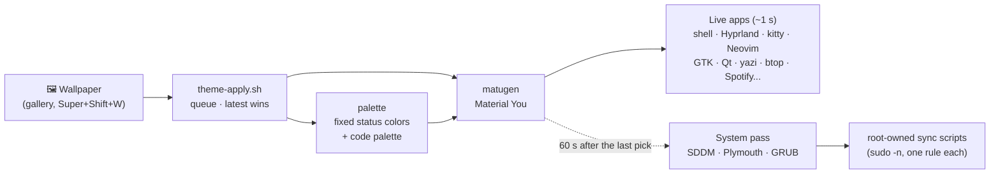

<h3 align="center">
  
  Hyprland Dotfiles
  
  <br/>
  <a href="https://github.com/h3n-x/hyprland-dotfiles">A complete Hyprland desktop where every color comes from your wallpaper</a>
  <br/><br/>
  <p>
    🌐 <strong>English</strong> · <a href="README.es.md">Español</a>
  </p>
</h3>

<p align="center">
  
  
  
  
</p>

<p align="center">
  
  
  
</p>

<p align="center">
  <a href="docs/en/guide.md">Guide</a>
  ·
  <a href="#-quick-start">Install</a>
  ·
  <a href="#%EF%B8%8F-keybinds">Keybinds</a>
  ·
  <a href="LICENSE">License</a>
</p>

&nbsp;

## 🪄 About

Pick a wallpaper and the **whole system takes its colors**: the bar and every panel, the terminal and the editor, GTK and Qt
apps, the file managers, Spotify, the lock screen, the login screen, the boot splash and the boot menu. The palette is
Material You, generated by [matugen](https://github.com/InioX/matugen) from the image, so a calm photo gives a calm desktop
and a vivid one a vivid desktop, while warnings, errors and success keep fixed, readable colors.

The shell is written from scratch in QML with [Quickshell](https://quickshell.org): bar, dashboard, control center,
launcher, notifications, wallpaper gallery, lock screen and a settings center where everything is configurable without
touching a file. It runs on any hardware: the GPU setup is detected, not hardcoded, and every option that depends on your
machine (displays, VRR, HDR, power profiles) appears only when your hardware supports it.

> [!TIP]
> Curious but cautious? `./install.sh --dry-run` shows every command the installer would run, without changing anything.

&nbsp;

## 🎨 Preview

<table>
  <tr>
    <td></td>
    <td></td>
  </tr>
  <tr>
    <td colspan="2" align="center"><sub>The same apps, two wallpapers: everything recolors, from the bar to the editor's syntax</sub></td>
  </tr>
  <tr>
    <td></td>
    <td></td>
  </tr>
  <tr>
    <td align="center"><sub>Dashboard (<code>Super + A</code>): home, music, system, workspaces</sub></td>
    <td align="center"><sub>Settings center (<code>Super + I</code>): every option, searchable</sub></td>
  </tr>
  <tr>
    <td></td>
    <td></td>
  </tr>
  <tr>
    <td align="center"><sub>Wallpaper gallery (<code>Super + Shift + W</code>) with a live preview</sub></td>
    <td align="center"><sub>Login screen, the same surface the lock screen uses</sub></td>
  </tr>
</table>

&nbsp;

## ✨ Highlights

| | |
|---|---|
| 🎨 **One wallpaper, one palette** | About 20 apps recolor live in ~1 s: Hyprland borders, the shell, kitty, Neovim, btop, yazi, cava, zellij, glow, fzf, starship, GTK 3/4 (Thunar, nwg-look...), Qt, Papirus folder icons, Spotify, NetBeans. Light, dark or automatic mode. |
| 🖼️ **Wallpaper gallery** | `Super + Shift + W`: search, tags, favorites, recent, a live preview, and color options per wallpaper (scheme, contrast, mode) or for all. `Super + Shift + Z` undoes the last theme. |
| 🧩 **A complete shell** | Bar (horizontal or vertical), dashboard with tabs, control center with editable quick tiles, launcher, window switcher, clipboard history, emoji picker, notification center, OSD, power menu. |
| 💻 **Code colors that follow the image** | A varied syntax palette harmonized toward the wallpaper and solved for contrast, shared by Neovim, NetBeans, kitty and glow. |
| 📸 **Captures** | Monitor, region or window with a preview to annotate (satty), copy, open or trash; screen recording with a pill in the bar. |
| 🔐 **Lock, login and boot** | A supervised lock screen with crash recovery, an SDDM greeter, a Plymouth splash and a GRUB theme, all from the same palette. |
| 🎛️ **Configurable without files** | `Super + I`: displays (with a 15 s try-and-revert), night light, fonts, interface scale, reduced motion, bar layout, dashboard zones, captures, power... |
| 🌍 **Three languages** | English, Spanish and Japanese, switched live, from the bar to the boot menu. |
| ⚡ **Light on resources** | Nothing polls while closed, animations run only on real changes, services start on demand. |

&nbsp;

## 🧭 How it works



The live pass recolors what you see right away; the system pass waits a minute so browsing wallpapers doesn't rebuild the
boot image each time. Details for every app are in the [guide](docs/en/guide.md).

&nbsp;

## 🐧 Supported distributions

| Distribution | Status | Notes |
|---|---|---|
| **Arch Linux** | ✅ Tested | The reference |
| **EndeavourOS** | ✅ Tested | Uses its yay; dracut and systemd-boot handled |
| **CachyOS** | ✅ Tested | AUR packages it already builds come from its repos; Limine handled |
| **Garuda** | ✅ Tested | paru and Chaotic-AUR used when present |
| **Manjaro** | ✅ Tested | The installer stops if its packages are older than the config needs |
| **Artix** | ⚠️ Best effort | OpenRC, runit, dinit, s6; offers Arch's repositories (some packages are only there) |

Each one is installed from scratch in a container: a full install, a second run that changes nothing, `doctor` and an
uninstall. Any other distribution that declares itself Arch-based is accepted with a warning.

&nbsp;

## 🚀 Quick start

```bash
git clone https://github.com/h3n-x/hyprland-dotfiles.git ~/Dotfiles
cd ~/Dotfiles
./install.sh --dry-run   # see what it would do
./install.sh             # do it
```

Then log out and choose the **Hyprland (uwsm)** session (just **Hyprland** without systemd).

> [!IMPORTANT]
> Run it as your user: it asks for sudo once. Any config file of yours that would be replaced is moved first to
> `~/.local/state/dotfiles/backup-<date>/`, never overwritten, and `./install.sh uninstall` puts it back.

&nbsp;

## ⚙️ Installer

```
./install.sh [command] [options]
```

| Command | What it does |
|---|---|
| `install` | Everything below, in order (default) |
| `deps` | The profile's packages (repositories and AUR) and a version check |
| `services` | NetworkManager, bluetooth, power profiles (asks if another power manager is active) |
| `files` | Links the configuration with GNU Stow, backing up what's in the way |
| `first-run` | The first color palette and avatar |
| `apps` | Sets up the personal apps (profile `full`) |
| `system [sddm\|plymouth\|grub\|gpu]` | Optional system steps (below) |
| `doctor` | Checks an installation and changes nothing |
| `uninstall` | Removes the links, restores your backup and, if you want, the packages it added |

| Option | |
|---|---|
| `--dry-run`, `-n` | Show every command without running it |
| `--yes`, `-y` | No questions: take the default answers |
| `--profile minimal\|full` | `minimal`: the desktop. `full`: also development tools and apps (Spotify, NetBeans) |
| `--with` / `--without G1,G2` | Add or leave out package groups |
| `--no-aur` | No AUR: install the repository alternatives |
| `--aur-helper yay\|paru` | Which AUR helper to use (it offers to install yay if there's none) |
| `--with-system` | Also run the system steps |
| `--lang es\|en\|ja` | Language of the messages |

The package lists are plain text in [`install/packages/`](install/packages), one package per line with a comment saying
who uses it.

&nbsp;

## 🛡️ System steps

Optional, because they touch root-owned files. `./install.sh system` detects what your machine has before asking about
each one, and never runs with `--yes` alone:

| Step | What you get |
|---|---|
| `sddm` | The login screen, from the next boot. It asks before replacing another login manager and never starts it in your open session. |
| `plymouth` | The boot splash: its initramfs hook (mkinitcpio or dracut) and `quiet splash` where your boot loader reads it (UKI, systemd-boot, GRUB, Limine, rEFInd). |
| `grub` | The boot menu theme, only if you boot with GRUB. |
| `gpu` | On a hybrid laptop: Hyprland on the integrated GPU, NVIDIA modesetting and suspend. |

Each installs a root-owned copy of its sync script with a sudoers rule limited to it (validated with `visudo`), so a
wallpaper change updates it without a password. A boot file it edits is copied to `<file>.dotfiles-orig` first.

&nbsp;

## ⌨️ Keybinds

`Super + /` opens a searchable guide on the system. The essentials:

| Shortcut | Action |
|---|---|
| `Super` + `Enter` | Terminal |
| `Super` + `D` | App launcher |
| `Super` + `A` | Dashboard |
| `Super` + `N` | Control center |
| `Super` + `I` | Settings |
| `Super` + `Shift` + `W` | Wallpaper gallery |
| `Super` + `Shift` + `V` | Clipboard |
| `Super` + `L` | Lock the screen |
| `Super` + `/` | Shortcut guide |

<details>
<summary><b>All keybinds</b> (generated from <code>binds.lua</code> by <code>keybinds readme</code>)</summary>

<!-- keybinds:start (generated: hypr/.config/hypr/scripts/keybinds readme) -->
**Shell**

| Shortcut | Action |
|---|---|
| `Super` + `D` | App launcher |
| `Super` + `Tab` or `Super` + `Shift` + `Tab` | Switch window |
| `Super` + `A` | Dashboard |
| `Super` + `N` | Control center |
| `Super` + `Shift` + `N` | Clear notifications |
| `Super` + `Shift` + `B` | Show or hide the bar |
| `Super` + `Ctrl` + `Shift` + `B` | Reload the shell |
| `Super` + `Shift` + `V` | Clipboard |
| `Super` + `.` | Emoji |
| `Super` + `/` | Shortcut guide |
| `Super` | Show the bar (hold) |

**Apps**

| Shortcut | Action |
|---|---|
| `Super` + `Enter` | Terminal |
| `Super` + `E` | Files |
| `Super` + `B` | Browser |
| `Super` + `Shift` + `C` | Color picker |

**System**

| Shortcut | Action |
|---|---|
| `Super` + `I` | Settings |
| `Super` + `L` | Lock the screen |
| `Super` + `Ctrl` + `Alt` + `L` | Emergency lock |
| `Super` + `M` | Power and session |
| `Super` + `Shift` + `M` | Log out |
| `Super` + `Ctrl` + `Shift` + `M` | Emergency exit |
| `Super` + `Alt` + `G` | Game mode |
| `Caps Lock` | Caps Lock state |
| `Num Lock` | Num Lock state |

**Windows**

| Shortcut | Action |
|---|---|
| `Super` + `Q` | Close the window |
| `Super` + `Shift` + `Q` | Force close |
| `Super` + `V` | Floating |
| `Super` + `F` | Fullscreen |
| `Super` + `Shift` + `P` | Pin on every workspace |
| `Super` + `C` | Center |
| `Super` + `P` | Pseudotile |
| `Super` + `J` | Toggle the split |
| `Super` + `G` | Group |
| `Super` + `Shift` + `G` | Lock the group |
| `Super` + `Arrows` | Move focus |
| `Super` + `Shift` + `Arrows` | Move the window |
| `Super` + `Ctrl` + `Arrows` | Resize |
| `Super` + `Left click` / `Left Ctrl` | Move with the mouse |
| `Super` + `Right click` / `Left Alt` | Resize with the mouse |
| `Super` + `R` | Resize mode |

**Workspaces**

| Shortcut | Action |
|---|---|
| `Super` + `1 … 0` | Go to workspace |
| `Super` + `Shift` + `1 … 0` | Move to workspace |
| `Super` + `Wheel` | Cycle workspaces |
| `Super` + `S` | Special workspace |
| `Super` + `Shift` + `S` | Move to special |
| `Super` + `Alt` + `L` | Switch the layout |

**Capture**

| Shortcut | Action |
|---|---|
| `Print` | Capture the monitor |
| `Super` + `Print` | Capture a region |
| `Super` + `Shift` + `Print` | Capture the window |
| `Super` + `Alt` + `R` | Record an area |
| `Super` + `Alt` + `Shift` + `R` | Record the monitor |

**Theme**

| Shortcut | Action |
|---|---|
| `Super` + `Shift` + `W` | Wallpaper gallery |
| `Super` + `Shift` + `Z` | Undo the last theme |

**Media**

| Shortcut | Action |
|---|---|
| `Volume up` / `Volume down` | Volume |
| `Mute` | Mute |
| `Microphone` | Mute the microphone |
| `Brightness up` / `Brightness down` | Brightness |
| `Previous` / `Next` | Next or previous track |
| `Play/Pause` | Play or pause |

**Resize mode** (mode: `Super` + `R`, leave with `Esc`/`Enter`)

| Shortcut | Action |
|---|---|
| `Arrows` | Resize |
| `Esc` / `Enter` | Leave the mode |
<!-- keybinds:end -->

</details>

&nbsp;

## 🎛️ Make it yours

- **Settings center** (`Super + I`): every option with a search field and a "your changes" view; options that don't apply
  to your machine say why. Changes are stored as overrides in `~/.config/dotfiles/settings.json`, the repo stays clean.
- **Per wallpaper**: color scheme, contrast and mode can be pinned to one image from the gallery.
- **Your hardware stays yours**: GPU variables and Qt configs are generated per machine, never tracked.

&nbsp;

## 🌍 Languages

The whole interface (bar, panels, settings, lock and login screens, boot menu, notifications and script messages) is
available in **English, Spanish and Japanese**, switched live in Settings → Appearance → Language. Adding a language is one
JSON catalog: see [Translating](docs/en/guide.md#translating). Corrections to the Japanese translation are welcome.

&nbsp;

## 📚 Documentation

| Resource | Description |
|---|---|
| [docs/en/guide.md](docs/en/guide.md) | How every piece works: packages, GPU, stow, each app's theming, the shell's modules, SDDM, Plymouth, GRUB, translating |
| [docs/es/guide.md](docs/es/guide.md) | The same, in Spanish |
| [install/packages/](install/packages) | What gets installed, and why |
| [README.es.md](README.es.md) | This readme in Spanish |

&nbsp;

## 🙋 FAQ

 - **Q: _Will it break my current setup?_** \
   **A:** It backs up every file it would replace and `./install.sh uninstall` restores them. Run `--dry-run` first to
   see exactly what changes.

 - **Q: _I have an Intel/AMD/NVIDIA-only machine, not a hybrid laptop._** \
   **A:** That's fine. The GPU setup is detected: hybrid laptops get Hyprland on the integrated GPU, NVIDIA-only machines get
   the NVIDIA variables, and AMD or Intel need nothing.

 - **Q: _Do I need the login screen, splash and boot menu?_** \
   **A:** No, they're optional system steps. The desktop works with any login manager and boot setup.

 - **Q: _How do I check an existing install?_** \
   **A:** `./install.sh doctor`: packages and versions, services, links, palette, root copies, GPU and Qt, without
   changing anything.

 - **Q: _Can I use only some parts?_** \
   **A:** Yes. Each folder is a GNU Stow package (`stow kitty`, `stow nvim`...), and `install.sh` runs any single step.

&nbsp;

## 💝 Thanks

- [Hyprland](https://hyprland.org), [Quickshell](https://quickshell.org), [matugen](https://github.com/InioX/matugen) and
  Google's Material You color system
- [GNU Stow](https://www.gnu.org/software/stow/) and the [ArchWiki](https://wiki.archlinux.org/)
- The Spotify theme starts from [catppuccin/spicetify](https://github.com/catppuccin/spicetify) (MIT, see
  `spicetify/.config/spicetify/Themes/matugen/LICENSE-catppuccin`)

&nbsp;

<p align="center">
  
</p>

<p align="center">
  Copyright © 2026 <a href="https://github.com/h3n-x">h3n-x</a>
</p>

<p align="center">
  <a href="LICENSE"></a>
</p>
