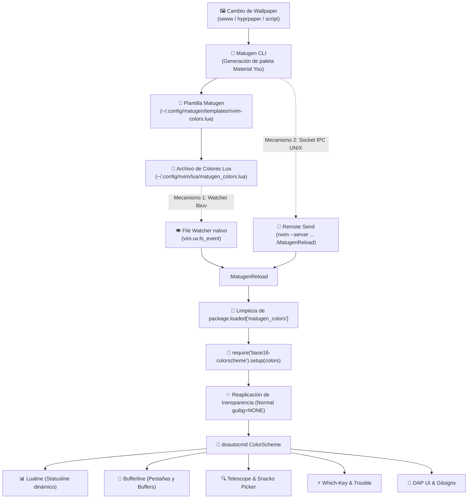

# 🚀 Neovim 0.12+ Material You IDE Rice

Configuración modular, minimalista y de nivel de producción (*production-grade*) para **Neovim v0.12.5+**, fuertemente integrada con el ecosistema **Arch Linux (Wayland) + Hyprland + kitty + zsh**, conservando y maximizando el sistema de **theming dinámico Material You con [Matugen](https://github.com/InioX/matugen)**.

---

## 🎨 Theming Dinámico: Matugen & Base16

A diferencia de las configuraciones convencionales que fijan un tema estático (como Tokyonight o Catppuccin), toda la interfaz de este editor deriva dinámicamente sus paletas de color en base al **wallpaper activo del sistema**, sincronizándose automáticamente con Hyprland, kitty, Waybar y el resto del rice.

### Diagrama de Flujo de Sincronización



### Mecanismos de Recarga Implementados

1. **File Watcher Nativo de Neovim (`vim.uv.fs_event`)**:
   - Neovim utiliza las APIs nativas de libuv (`vim.uv.new_fs_event()`) para vigilar el archivo `lua/matugen_colors.lua`.
   - Incorpora un temporizador de *debounce* de 100ms para evitar recargas duplicadas ocasionadas por operaciones de escritura atómica (escritura temporal + rename) de Matugen.
   - Tan pronto como Matugen genera el archivo, Neovim lo detecta y repinta la interfaz en milisegundos sin requerir interacción manual.

2. **Socket IPC UNIX (`nvim --server`)**:
   - Cada instancia de Neovim expone un socket UNIX en `${XDG_RUNTIME_DIR}/nvim.*`.
   - La configuración de Matugen (`~/.config/matugen/config.toml`) incluye un `post_hook` que notifica a todas las instancias en ejecución:
     ```bash
     for s in ${XDG_RUNTIME_DIR:-/run/user/$(id -u)}/nvim.*; do
         [ -S "$s" ] && nvim --server "$s" --remote-send '<C-\><C-N>:MatugenReload<CR>' 2>/dev/null || true
     done
     ```

3. **Recarga Manual**:
   - Puedes forzar la recarga en cualquier momento ejecutando `:MatugenReload` o presionando `<leader>mr`.

### Transparencia y Armonía Visual (Hyprland + kitty)
- **Fondo Translúcido**: Si `vim.g.transparent_background = true` (activado por defecto), los grupos `Normal`, `NormalFloat`, `FloatBorder`, etc., tienen `guibg=NONE`.
- **Integración con kitty**: `kitty.conf` cuenta con `background_opacity 0.92` y `dynamic_background_opacity yes`. El fondo de Neovim hereda exactamente esa opacidad y el efecto de desenfoque (*blur*) gestionado por Hyprland.
- **Regla Hyprland recomendada**:
  ```ini
  # En ~/.config/hypr/hyprland.conf o modules/windowrules.conf
  windowrulev2 = opacity 0.92 0.92, class:^(kitty)$
  windowrulev2 = nodim, class:^(kitty)$
  ```

---

## 📁 Estructura del Proyecto

```text
~/.config/nvim/ (-> ~/Dotfiles/nvim/.config/nvim)
├── init.lua                     # Entrypoint ultra limpio (<15 líneas con vim.loader)
├── install.sh                   # Script de aprovisionamiento idempotente para Arch Linux
├── lazy-lock.json               # Lockfile reproducible para lazy.nvim
├── lsp/                         # Definiciones nativas de servidores LSP (Neovim 0.12+)
│   ├── bashls.lua
│   ├── clangd.lua
│   ├── cssls.lua
│   ├── dockerls.lua
│   ├── gopls.lua
│   ├── html.lua
│   ├── jsonls.lua
│   ├── lua_ls.lua
│   ├── marksman.lua
│   ├── pyright.lua
│   ├── rust_analyzer.lua
│   ├── ts_ls.lua
│   └── yamlls.lua
└── lua/
    ├── matugen_colors.lua       # Autogenerado por Matugen (base00-base0F hex)
    ├── config/
    │   ├── autocmds.lua         # Eventos de ciclo de vida, buffers y terminal
    │   ├── keymaps.lua          # Atajos generales y navegación de ventanas
    │   ├── lazy.lua             # Bootstrap de folke/lazy.nvim
    │   ├── matugen.lua          # Módulo core de theming, watcher libuv y :MatugenReload
    │   └── options.lua          # Opciones de editor, rendimiento y Wayland
    └── plugins/
        ├── bufferline.lua       # Pestañas y buffers superiores
        ├── colorscheme.lua      # RRethy/base16-nvim + integración Matugen
        ├── completion.lua       # saghen/blink.cmp + LuaSnip + friendly-snippets
        ├── dap.lua              # nvim-dap + dap-ui + mason-nvim-dap
        ├── editing.lua          # autopairs, nvim-surround, mini.ai
        ├── explorer.lua         # Snacks Explorer (<leader>e) y Yazi (<leader>-)
        ├── flash.lua            # folke/flash.nvim (salto rápido en 2 teclas)
        ├── formatting.lua       # conform.nvim + :FormatToggle
        ├── git.lua              # gitsigns.nvim, diffview.nvim y lazygit
        ├── linting.lua          # nvim-lint (shellcheck, markdownlint)
        ├── lsp.lua              # mason, mason-lspconfig, vim.lsp.config/enable
        ├── markdown.lua         # render-markdown.nvim
        ├── session.lua          # folke/persistence.nvim (sesiones por proyecto)
        ├── snacks.lua           # folke/snacks.nvim (dashboard, terminal, notifier)
        ├── telescope.lua        # telescope.nvim + fzf-native
        ├── treesitter.lua       # nvim-treesitter (main branch) + textobjects
        └── ui.lua               # lualine.nvim dinámico, which-key, trouble
```

---

## ⌨️ Tabla Completa de Atajos de Teclado (Keymaps)

La tecla `<leader>` es la barra espaciadora (`<Space>`).

### 🔍 Búsqueda y Navegación (`<leader>f` / Telescope & Snacks)
| Atajo | Acción | Motor |
|---|---|---|
| `<leader><space>` | Búsqueda inteligente de archivos | Snacks Picker |
| `<leader>ff` | Buscar archivos del proyecto | Telescope |
| `<leader>fg` | Búsqueda global de texto (Live Grep) | Telescope |
| `<leader>fb` / `<leader>,` | Listar buffers abiertos | Telescope / Snacks |
| `<leader>fr` | Archivos abiertos recientemente | Telescope |
| `<leader>fs` | Símbolos LSP del archivo actual | Telescope |
| `<leader>fS` | Símbolos LSP de todo el workspace | Telescope |
| `<leader>fd` | Diagnósticos del proyecto | Telescope |
| `<leader>fh` | Buscar en manuales de ayuda | Telescope |
| `<leader>fk` | Explorar atajos de teclado registrados | Telescope |
| `<leader>/` | Buscar texto en el buffer actual | Telescope |
| `<leader>e` | Abrir explorador de archivos lateral | Snacks Explorer |
| `<leader>-` | Abrir explorador de archivos TUI | Yazi |

### 🛠️ LSP y Asistencia de Código (`<leader>c` / `<leader>l` / Modales)
| Atajo | Acción |
|---|---|
| `gd` | Saltar a la definición del símbolo |
| `gD` | Saltar a la declaración |
| `gr` | Ver todas las referencias |
| `gI` | Ir a la implementación |
| `gy` | Ir a la definición del tipo |
| `K` | Mostrar documentación flotante (*Hover*) |
| `<C-k>` | Mostrar ayuda de firma de función (*Signature Help*) |
| `<leader>cr` / `<leader>rn` | Renombrar símbolo en todo el proyecto (*LSP Rename*) |
| `<leader>ca` | Acciones de código (*Code Actions*) |
| `<leader>cd` | Abrir diagnóstico flotante de la línea actual |
| `[d` / `]d` | Saltar al diagnóstico anterior / siguiente |
| `<leader>uh` | Alternar pistas de tipo (*Inlay Hints*) |
| `<leader>cf` | Formatear archivo o selección actual (*Conform*) |
| `<leader>uf` | Alternar formateo automático al guardar (`:FormatToggle`) |
| `<leader>cm` | Abrir panel de instalación Mason |

### 🚨 Diagnósticos y Listas (`<leader>x` / Trouble)
| Atajo | Acción |
|---|---|
| `<leader>xx` | Panel de diagnósticos del proyecto (Trouble) |
| `<leader>xX` | Panel de diagnósticos del buffer actual |
| `<leader>cs` | Árbol de símbolos y clases del buffer |
| `<leader>cl` | Panel lateral de definiciones y referencias LSP |
| `<leader>xt` | Listado general de `TODO`, `FIXME`, `BUG` |
| `]t` / `[t` | Saltar al siguiente / anterior `TODO` |

### 🔀 Git y Control de Versiones (`<leader>g` / `<leader>h`)
| Atajo | Acción |
|---|---|
| `<leader>gg` | Abrir Lazygit en terminal flotante |
| `<leader>gd` | Abrir comparador side-by-side (Diffview) |
| `<leader>gD` | Cerrar comparador Diffview |
| `<leader>gh` | Historial Git del archivo actual |
| `<leader>gH` | Historial Git de todo el repositorio |
| `<leader>gc` | Historial de commits interactivo (Telescope) |
| `<leader>gs` | Estado de cambios del árbol de trabajo (Telescope) |
| `]h` / `[h` | Saltar al siguiente / anterior hunk modificado |
| `<leader>hs` | Hacer stage del hunk actual |
| `<leader>hr` | Descartar / revertir el hunk actual |
| `<leader>hp` | Previsualizar diferencias del hunk en ventana flotante |
| `<leader>gb` | Ver Git Blame de la línea actual |
| `<leader>ub` | Alternar Git Blame en línea continuo |

### 🐞 Depuración DAP (`<leader>d`)
| Atajo | Acción |
|---|---|
| `<leader>db` | Alternar punto de interrupción (*Breakpoint*) |
| `<leader>dB` | Breakpoint condicional |
| `<leader>dc` | Continuar / Iniciar depuración |
| `<leader>di` | Paso dentro (*Step Into*) |
| `<leader>do` | Paso por encima (*Step Over*) |
| `<leader>dO` | Paso fuera (*Step Out*) |
| `<leader>dt` | Terminar sesión de depuración |
| `<leader>du` | Alternar interfaz gráfica de depuración (DAP UI) |
| `<leader>dr` | Abrir consola REPL interactiva de depuración |

### 📑 Buffers y Pestañas (`<leader>b` / Bufferline)
| Atajo | Acción |
|---|---|
| `<S-l>` / `]b` | Siguiente buffer |
| `<S-h>` / `[b` | Buffer anterior |
| `<leader>bd` | Cerrar buffer actual (sin alterar splits) |
| `<leader>bp` | Fijar / Desfijar buffer (*Pin*) |
| `<leader>bo` | Cerrar todos los demás buffers excepto el actual |
| `<leader>bP` | Cerrar todos los buffers no fijados |
| `<leader>br` / `<leader>bl` | Cerrar buffers situados a la derecha / izquierda |

### 🪟 Ventanas y Terminal Integrada
| Atajo | Modo | Acción |
|---|---|---|
| `<C-h>` / `<C-j>` / `<C-k>` / `<C-l>` | Normal | Cambiar foco entre splits (izquierda, abajo, arriba, derecha) |
| `<C-h>` / `<C-j>` / `<C-k>` / `<C-l>` | Terminal | Navegación entre splits directamente desde el buffer de terminal |
| `<Esc>` | Terminal | Salir del modo terminal a modo normal |
| `<leader>sv` | Normal | Dividir ventana verticalmente |
| `<leader>sh` | Normal | Dividir ventana horizontalmente |
| `<leader>se` | Normal | Igualar dimensiones de ventanas divididas |
| `<leader>sx` | Normal | Cerrar división actual |
| `<leader>t` / `<C-/>` | Normal | Alternar terminal flotante integrada (Snacks) |

---

## ➕ Cómo Añadir un Nuevo Servidor LSP / Lenguaje

Gracias a la arquitectura nativa basada en `vim.lsp.config()` de Neovim 0.12, añadir soporte para un nuevo lenguaje es modular y directo:

1. **Crear archivo de configuración del servidor**:
   Crea `~/.config/nvim/lsp/<nuevo_server>.lua`:
   ```lua
   return {
       cmd = { "servidor-binario", "--stdio" },
       filetypes = { "mi_lenguaje" },
       root_markers = { { "config.json" }, { ".git" } },
       settings = {
           mi_lenguaje = {
               -- opciones del servidor
           },
       },
   }
   ```

2. **Registrar en la lista de servidores activos**:
   En `~/.config/nvim/lua/plugins/lsp.lua`, añade el nombre del servidor al array `servers`:
   ```lua
   local servers = {
       "lua_ls",
       "pyright",
       -- ...
       "<nuevo_server>",
   }
   ```
   *Mason y mason-lspconfig lo instalarán automáticamente al iniciar Neovim.*

3. **Registrar Formateador o Linter (Opcional)**:
   - Si tiene formateador dedicado, agrégalo en `lua/plugins/formatting.lua` bajo `formatters_by_ft`.
   - Si tiene linter independiente, agrégalo en `lua/plugins/linting.lua` bajo `linters_by_ft`.

---

## 🔄 Actualización y Mantenimiento

- **Actualizar Plugins**:
  ```vim
  :Lazy update
  ```
- **Medir Rendimiento y Tiempos de Arranque**:
  ```vim
  :Lazy profile
  ```
  *(El tiempo de inicio objetivo está optimizado para situarse por debajo de los 80ms gracias a la carga diferida agresiva y la exclusión de built-ins heredados).*
- **Comprobar Salud del Entorno**:
  ```vim
  :checkhealth
  ```
- **Comprobar Estado de LSP**:
  ```vim
  :checkhealth vim.lsp
  ```

---

## 🛠️ Diagnóstico y Resolución de Problemas (Troubleshooting)

1. **¿Los colores de Neovim no cambian al cambiar de wallpaper?**
   - Comprueba que el archivo `~/.config/nvim/lua/matugen_colors.lua` se haya modificado con una marca de tiempo reciente:
     ```bash
     ls -l ~/.config/nvim/lua/matugen_colors.lua
     ```
   - Ejecuta manualmente `:MatugenReload` en Neovim para verificar que el repintado funcione.
   - Revisa si el hook de Matugen en `~/.config/matugen/config.toml` está presente en la sección `[templates.nvim]`.

2. **¿La transparencia no se aplica correctamente?**
   - Asegúrate de que `vim.g.transparent_background = true` esté definido en `lua/config/options.lua`.
   - Verifica que kitty tenga habilitada la transparencia interna en `~/.config/kitty/kitty.conf`:
     ```ini
     background_opacity 0.92
     dynamic_background_opacity yes
     ```

3. **¿El portapapeles del sistema no copia hacia aplicaciones externas?**
   - Confirma que `wl-clipboard` esté instalado en tu sistema:
     ```bash
     which wl-copy && wl-copy "Prueba de clipboard"
     ```
   - Neovim detecta automáticamente `wl-copy` bajo Wayland gracias a `vim.opt.clipboard = "unnamedplus"`.
